# 信跃操作与演示

## 不用输入命令的本机启动

在项目文件夹中双击`启动信跃网页.cmd`，等浏览器自动打开。该入口当前打开本机测试申请；平台首页是<http://127.0.0.1:5000/>，研究申请页是<http://127.0.0.1:5000/apply>。使用期间保持启动窗口打开；电脑重启或程序关闭后，再双击一次。本机页面仅本机可用，不能把127.0.0.1链接发给同学。

学习平台已于2026年10月27日发布到现有Render网址，由托管服务运行，参与者打开公网链接即可，研究者电脑无需保持开机。平台首页为<https://xinyue-risk-control.onrender.com/>，测试申请为<https://xinyue-risk-control.onrender.com/apply?test=1>；入口说明见`docs/打开网站.md`。

## 参与者：学习平台

从首页进入“金融素养测评”可完成16道平台自编题。每道题都可以选“暂不确定”；提交前不会显示对错解释，提交后显示答对题数、正确率（答对数÷16）、完成度、主题表现和建议复习主题。未作答和“暂不确定”都不计为正确。

“知识科普”有12篇短主题；“学习工具”可以试算借贷成本、分配生活费并做反诈判断。测评摘要、已读标记和工具使用状态只存在当前浏览器，不需要账号，也不会上传到服务器。换设备、使用无痕窗口或清理浏览器数据会丢失，可在“我的学习”中一并清除。

学习平台和研究申请分开：不完成学习测评也可以从导航进入申请；学习结果不会写入申请表，也不会改变研究条款。

## 参与者：研究申请

从平台首页的“申请体验”或直接打开`/apply`，阅读并勾选同意后点下一页。原有8页顺序保留。昵称可不填；收入和总负债自愿估算或留空。按顺序填写需求和利率，确认后完成上下两页29题量表，最后提交。旧测试/招募链接`/?test=1`、`/?source=...`会保留参数转到新地址。

顶部四段提示仅用于显示当前阶段，不允许跳过必填页。进度条是页码进度，不是审批进度。银行风格的布局不改变科研模拟性质。量表选择后数字框会突出显示，支持点击整个数字框与键盘操作。

“草稿已保存”表示草稿请求已获服务器确认，不代表最终提交。只有显示提交成功和保存回执，才表示申请与量表已最终保存。失败时保留当前页重试；同一标签页刷新可恢复进度，但关闭浏览器、清理存储或换设备不保证恢复。

## 研究者

进入`/admin/login`登录。本机首次使用且未配置管理员时，可从登录页进入首次设置。正式Render服务在环境变量中配置，不能通过公开网页设置账号。

后台每5秒同步最新记录。可按类型、状态、起止日期、招募来源和实验版本筛选。点击记录查看原始申请、29题答案、四个分量表分数与行为特征。

导出默认只选择正式已提交数据。试填时主动选择测试数据；未完成记录主动选择填写中。分析CSV为每次参与一行，行为明细为每个申请阶段事件一行。对照数据字典解释空值与质量标识。

## 学习平台演示（约1分钟）

1. 打开首页，说明“测一测—学一学—练一练”的入口，以及学习记录只在本浏览器。
2. 进入金融素养测评，选择几道题并保留一道空白，提交后展示正确率、完成度和逐题解释；说明“暂不确定”和未作答都不算答对。
3. 打开一篇科普，点击“标记为已读”，到“我的学习”查看阅读进度；再用默认数字运行一次借贷成本试算或生活费预算。
4. 说明学习测评不是标准化认证、信用评分或违约预测，学习数据也不进入研究CSV。

## 研究申请演示（2至3分钟）

1. 打开带`?test=1`的测试链接，展示原有8页表单和知情同意。
2. 在另一窗口登录后台。勾选同意、填写信息，等待自动刷新，展示新会话和草稿进度。
3. 在收入字段输入后删除一次，切换至总负债并修改，返回上一页，再前进；展示后台已接收到行为批次。
4. 展示量表上下两页和漏答提示，完成后提交，展示真实服务器回执。
5. 后台打开该TEST记录，核对原始答案、反向题与分量表，以及修改/时长等行为特征。
6. 主动选择测试记录导出CSV，明确它是功能验证数据，不是研究正式样本。

正式采集前用少量同学试填，检查移动网络、微信、页面理解和完整率；不要用测试生成的数据充当正式样本。学习平台的测评结果在独立页面提交后显示；研究申请仍不在主要测量完成前展示量表评分，也不生成个人信用结论。

## 真实界面截图

以下截图由独立测试库和真实Chrome流程生成，不是正式样本证明。学习平台截图只含本地演示状态；研究申请截图含测试模式标识。

### 公共学习平台

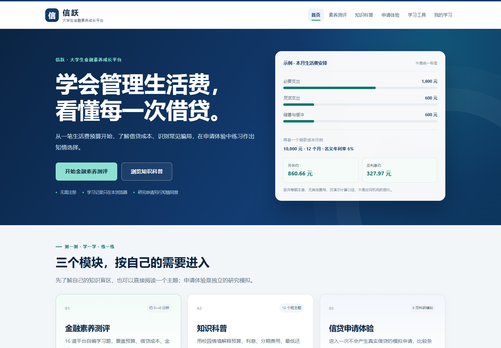

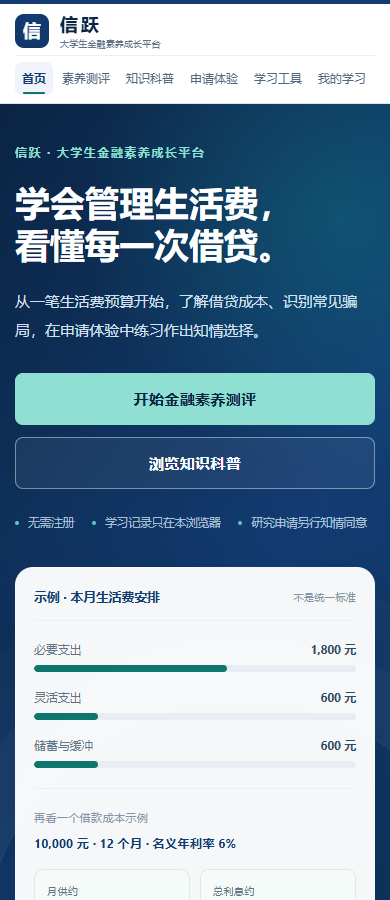

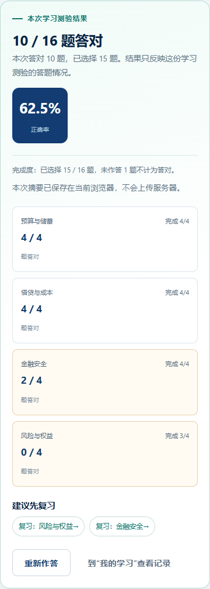

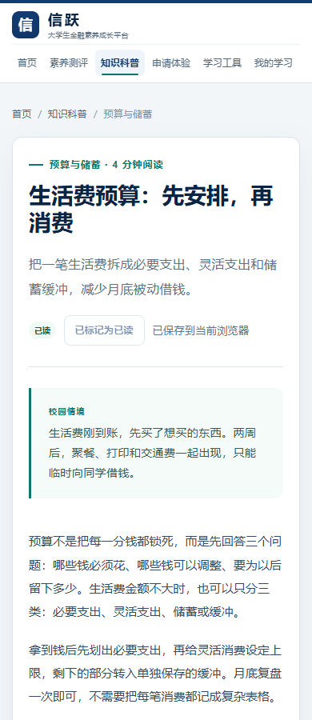

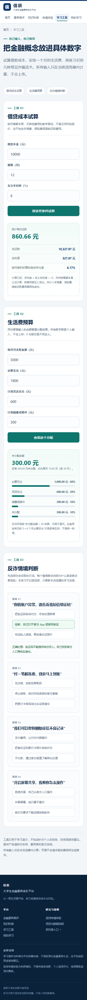

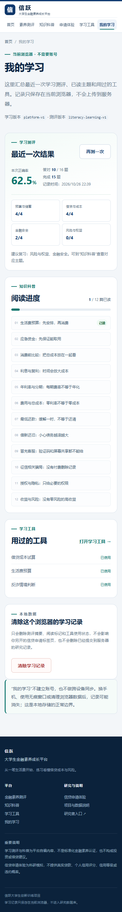

### 研究申请

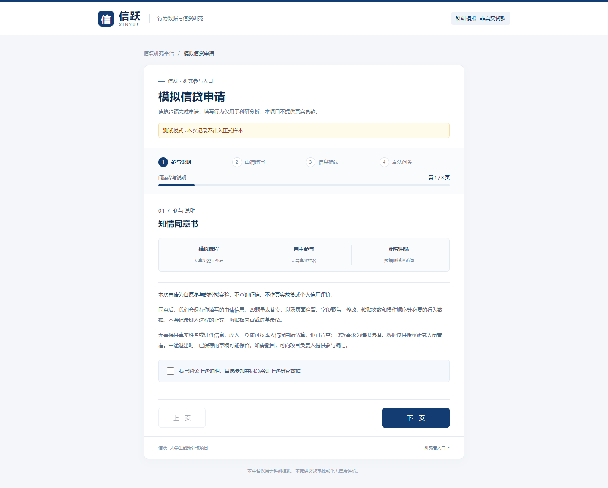

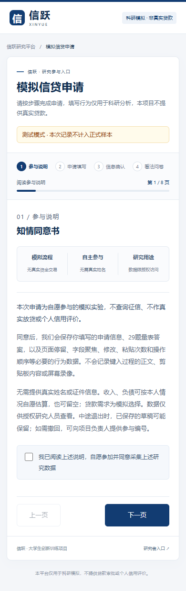

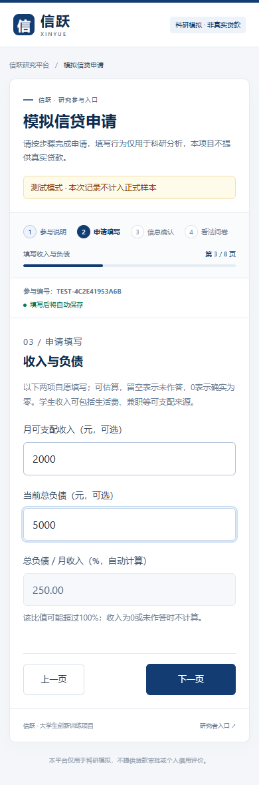

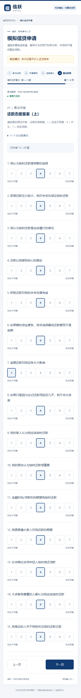

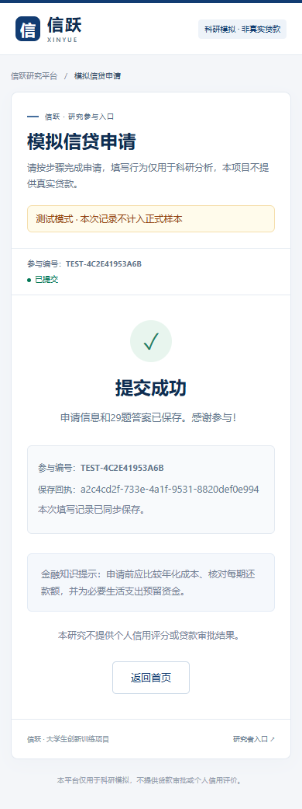
